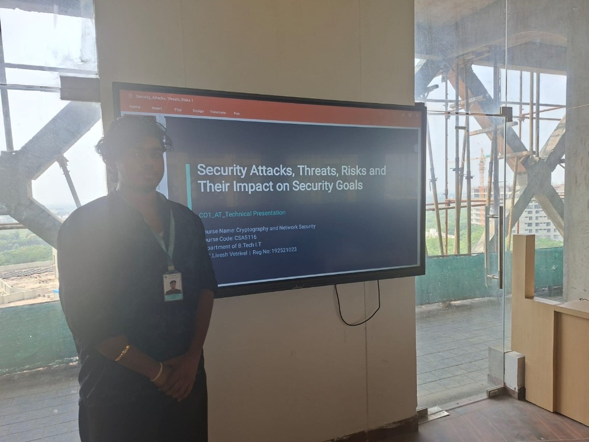

# CO1_AT3: Technical Presentation

## Security Attacks, Threats, Risks and Their Impact on Security Goals

**Course:** Cryptography and Network Security  
**Course Code:** CSA5116  
**Department:** Department of B.Tech Information Technology  
**Presented by:** M.S. Livesh Vetrivel  
**Register No:** 192521023  
**Institution:** Saveetha School of Engineering, SIMATS  

---

### 📸 Presentation Evidence

---

## 📌 Agenda

1. **Security Goals (CIA Triad +2)**
2. **Threat, Vulnerability, Attack, Risk**
3. **Types of Security Attacks (Passive vs. Active)**
4. **Impact of Attacks on Security Goals**
5. **Risk Analysis ($Risk = Likelihood \times Impact$)**
6. **Real-World Case Studies**
7. **Tools for Analyzing Threats**
8. **Countermeasures & Key Takeaways**

---

## 1. Security Goals: The CIA Triad (+2)

| Goal | Definition |
|---|---|
| **Confidentiality** | Ensures that only authorized parties can read sensitive data. |
| **Integrity** | Guarantees that data is not altered or tampered with without detection. |
| **Availability** | Ensures systems and data are accessible and operational when needed. |
| **Authentication** | Verifies the claimed identity of a user or system entity. |
| **Non-Repudiation** | Prevents senders from denying that they initiated or sent a message. |

> Every threat, attack, and risk is ultimately measured by which security goal it damages.

---

## 2. Threat, Vulnerability, Attack, and Risk

$$\text{Threat} + \text{Vulnerability} \longrightarrow \text{Attack} \longrightarrow \text{Impact on CIA}$$

- **Threat:** A potential danger that could exploit a weakness (e.g., hacker, malware, insider).
- **Vulnerability:** A weakness or flaw in a system, process, or person (e.g., unpatched software, weak passwords).
- **Attack:** An actual deliberate attempt to exploit a vulnerability and compromise a security goal.
- **Risk:** The probability (likelihood) of a threat exploiting a vulnerability multiplied by the impact it causes.

---

## 3. Types of Security Attacks

### Passive Attacks
*Goal: Learn or make unauthorized use of information without altering system resources.*
- **Eavesdropping / Packet Sniffing:** Intercepting unencrypted network communications.
- **Traffic Analysis:** Observing message patterns, volume, and frequency to deduce sensitive intelligence.
- **Release of Message Contents:** Unauthorized reading of confidential transmissions.
- *Detection:* Very difficult to detect in real-time $\rightarrow$ **Prevention through strong end-to-end encryption.**

### Active Attacks
*Goal: Alter system resources or disrupt operations.*
- **Masquerade (Impersonation):** Pretending to be an authorized entity.
- **Replay Attack:** Capturing valid data transmissions and maliciously retransmitting them later.
- **Modification of Messages:** Altering message content, order, or delay.
- **Denial of Service (DoS):** Overwhelming resources to prevent legitimate users from accessing services.

---

## 4. Impact of Attacks on Security Goals

| Attack Type | Confidentiality | Integrity | Availability |
|---|:---:|:---:|:---:|
| **Eavesdropping** | 🔴 **High** | ⚪ Low / None | ⚪ Low / None |
| **Message Modification** | ⚪ Low / None | 🔴 **High** | ⚪ Low / None |
| **Masquerade** | 🔴 **High** | 🔴 **High** | ⚪ Low / None |
| **Replay Attack** | ⚪ Low / None | 🔴 **High** | ⚪ Low / None |
| **Denial of Service (DoS)** | ⚪ Low / None | ⚪ Low / None | 🔴 **High** |
| **Ransomware** | 🔴 **High** | 🔴 **High** | 🔴 **High** |

---

## 5. Risk Analysis: $\text{Risk} = \text{Likelihood} \times \text{Impact}$

| Threat Scenario | Likelihood | Impact | Calculated Risk Level |
|---|:---:|:---:|:---:|
| **Phishing Campaign** | High | High | 🔴 **Critical** |
| **DoS Attack on Web Server** | Medium | High | 🟠 **High** |
| **Insider Data Leak** | Low | High | 🟡 **Medium** |
| **Weak Password / Brute-Force** | High | Medium | 🟠 **High** |
| **Physical Theft of Laptop** | Low | Medium | 🟢 **Low** |

---

## 6. Real-World Case Studies

1. **WannaCry (2017):**
   - Ransomware worm exploiting an unpatched Windows SMB vulnerability (EternalBlue).
   - Encrypted files worldwide across healthcare, logistics, and government networks.
   - **Goals Affected:** *Availability, Integrity*.

2. **Mirai Botnet (2016):**
   - Infected poorly secured IoT devices with default credentials to launch massive distributed DDoS attacks against Dyn DNS.
   - **Goal Affected:** *Availability*.

3. **Target Data Breach (2013):**
   - Attackers entered through compromised credentials of a third-party HVAC vendor and exfiltrated payment card data of 40+ million customers.
   - **Goal Affected:** *Confidentiality*.

---

## 7. Security Analysis Tools

- **Wireshark:** Network packet analyzer; captures and inspects traffic to diagnose unencrypted communication.
- **Nmap:** Network exploration and port scanner; identifies active hosts, open ports, and running services.
- **OpenVAS / Nessus:** Comprehensive vulnerability scanners; detect and prioritize software weaknesses and CVEs.
- **Burp Suite:** Web application penetration testing suite; detects injection, XSS, and authentication bypass flaws.

---

## 8. Countermeasures & Defense in Depth

- **Confidentiality Protection:** AES/RSA encryption, Role-Based Access Control (RBAC), VPN tunnels.
- **Integrity Protection:** Cryptographic hashes (SHA-256), Digital Signatures, HMACs.
- **Availability Protection:** Redundancy, failover clusters, automated backups, DDoS mitigation, web firewalls.
- **Authentication & Non-Repudiation:** Multi-Factor Authentication (MFA), PKI X.509 digital certificates.

---

## 🎯 Key Takeaways

1. **Threats** exploit **vulnerabilities** through **attacks**.
2. **Attacks** are categorized as **Passive** (targeting *Confidentiality*) or **Active** (targeting *Integrity* and *Availability*).
3. **$\text{Risk} = \text{Likelihood} \times \text{Impact}$** prioritizes cybersecurity investments and remediation.
4. **Layered controls (Defense in Depth)** are required to protect all security goals simultaneously.
