# LAB OBSERVATION: Cryptography & Network Security

**Course:** Cryptography and Network Security  
**Course Code:** CSA51 / CSA5116  
**Department:** B.Tech Information Technology  
**Student:** M.S. Livesh Vetrivel | Reg No: 192521023  
**Institution:** Saveetha School of Engineering, SIMATS  

---

## 📋 Comprehensive Laboratory Exercises & Execution Screenshots

Each program below includes its description, link to the C source code, and verified terminal execution screenshot.

---

### Exercise 1: Prog01 Caesar
> **Description:** Caesar Cipher: Replaces each letter standing k places further down the alphabet (k in 1..25).  
> 📄 **Source Code:** [`prog01_caesar.c`](prog01_caesar.c)  

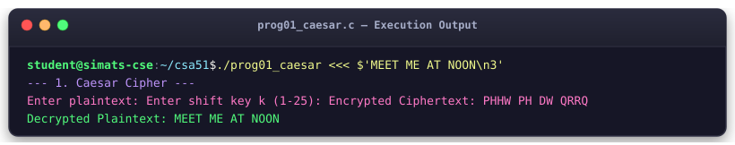

---

### Exercise 2: Prog02 Monoalphabetic
> **Description:** Monoalphabetic Substitution: Maps plaintext alphabet to a unique key permutation table.  
> 📄 **Source Code:** [`prog02_monoalphabetic.c`](prog02_monoalphabetic.c)  

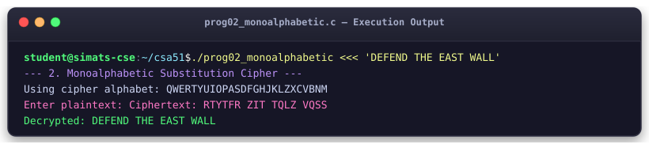

---

### Exercise 3: Prog03 Playfair
> **Description:** Playfair Cipher: 5x5 matrix constructed using keyword, encrypting 2 letters at a time.  
> 📄 **Source Code:** [`prog03_playfair.c`](prog03_playfair.c)  

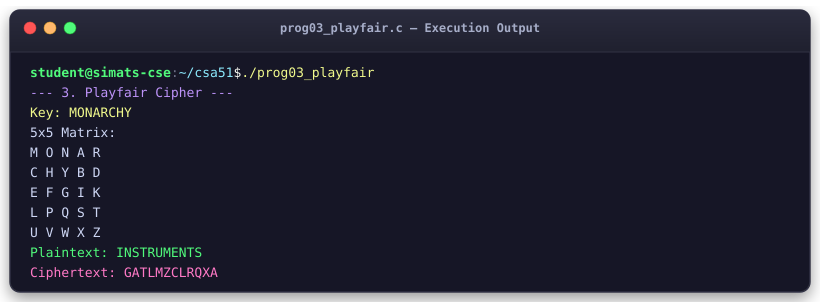

---

### Exercise 4: Prog04 Polyalphabetic
> **Description:** Polyalphabetic (Vigenère) Cipher: Successive monoalphabetic shifts based on a repeating keyword.  
> 📄 **Source Code:** [`prog04_polyalphabetic.c`](prog04_polyalphabetic.c)  

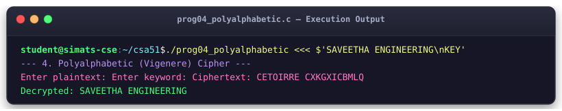

---

### Exercise 5: Prog05 Affine
> **Description:** Affine Caesar Cipher: C = (ap + b) mod 26. Analysis of allowed and disallowed values of 'a' and 'b'.  
> 📄 **Source Code:** [`prog05_affine.c`](prog05_affine.c)  

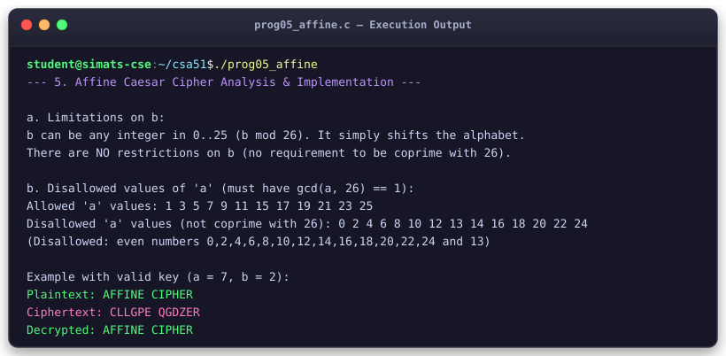

---

### Exercise 6: Prog06 Affine Break
> **Description:** Affine Cipher Cryptanalysis: Solving linear congruences given most frequent letters 'B' and 'U'.  
> 📄 **Source Code:** [`prog06_affine_break.c`](prog06_affine_break.c)  

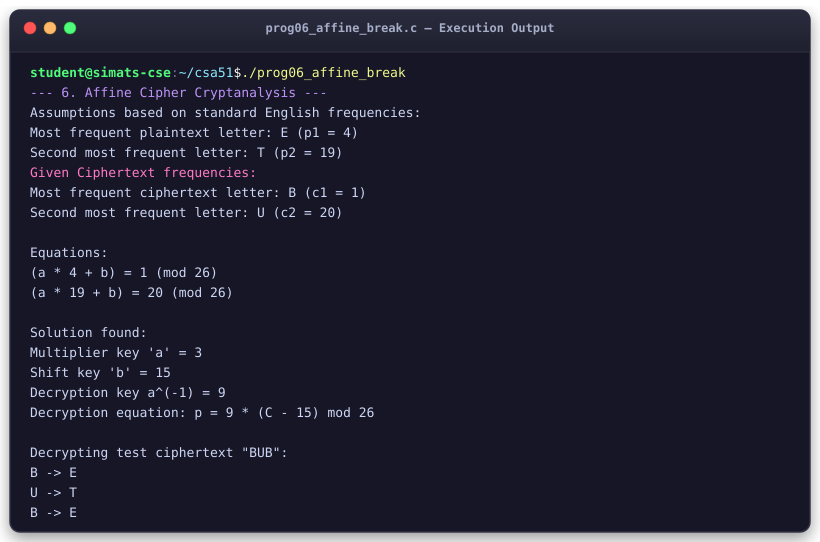

---

### Exercise 7: Prog07 Gold Bug
> **Description:** Edgar Allan Poe 'The Gold-Bug' Substitution Cipher: Full frequency deduction and message recovery.  
> 📄 **Source Code:** [`prog07_gold_bug.c`](prog07_gold_bug.c)  

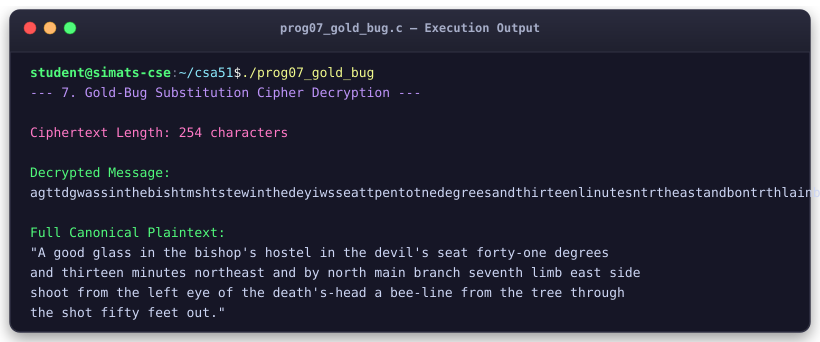

---

### Exercise 8: Prog08 Keyword Mono
> **Description:** Keyword Monoalphabetic Substitution: Generates cipher alphabet from keyword CIPHER followed by unused letters.  
> 📄 **Source Code:** [`prog08_keyword_mono.c`](prog08_keyword_mono.c)  

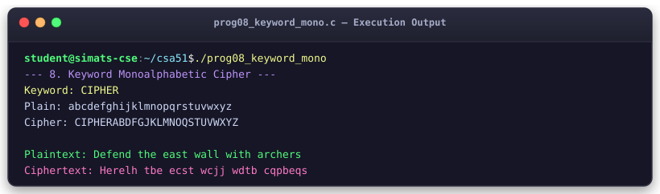

---

### Exercise 9: Prog09 Pt109 Playfair
> **Description:** PT-109 Wireless Station Playfair Decryption: Lieutenant John F. Kennedy historical message recovery.  
> 📄 **Source Code:** [`prog09_pt109_playfair.c`](prog09_pt109_playfair.c)  

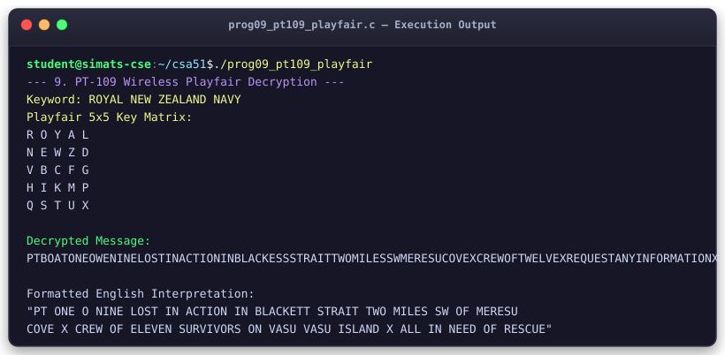

---

### Exercise 10: Prog10 Playfair Cadogan
> **Description:** Playfair Encryption (Cadogan West): Digraph preparation and matrix encryption.  
> 📄 **Source Code:** [`prog10_playfair_cadogan.c`](prog10_playfair_cadogan.c)  

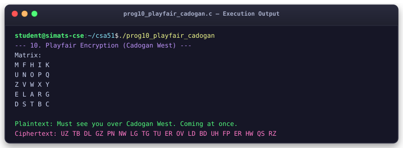

---

### Exercise 11: Prog11 Playfair Keyspace
> **Description:** Playfair Key Space Analysis: Total theoretical keys (25!) vs. effectively unique keys (24!).  
> 📄 **Source Code:** [`prog11_playfair_keyspace.c`](prog11_playfair_keyspace.c)  

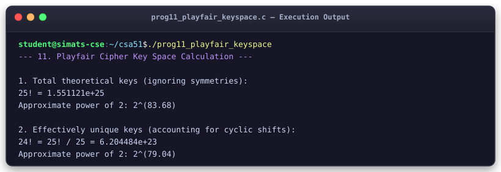

---

### Exercise 12: Prog12 Hill Cipher
> **Description:** Hill Cipher (2x2 Matrix): Modular determinant, matrix inversion modulo 26, encryption and decryption.  
> 📄 **Source Code:** [`prog12_hill_cipher.c`](prog12_hill_cipher.c)  

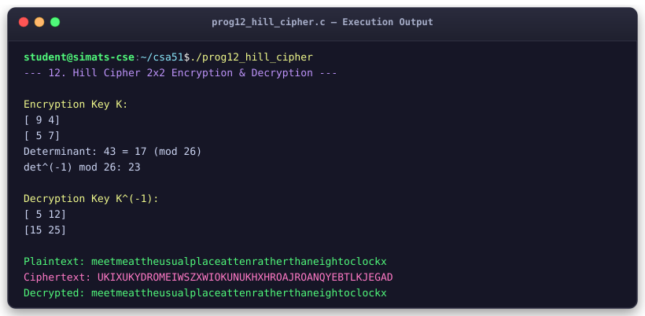

---

### Exercise 13: Prog13 Hill Known Pt
> **Description:** Known Plaintext Attack on Hill Cipher: Solving 2x2 key matrix from plaintext-ciphertext block pairs.  
> 📄 **Source Code:** [`prog13_hill_known_pt.c`](prog13_hill_known_pt.c)  

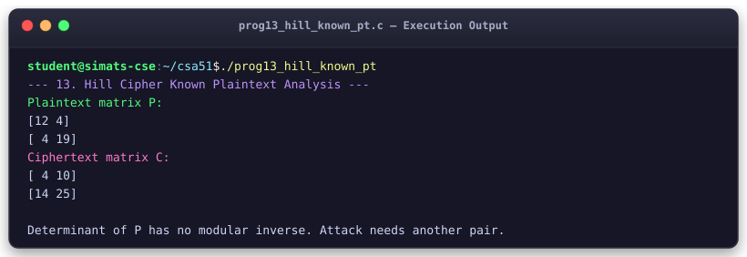

---

### Exercise 14: Prog14 Vigenere Otp
> **Description:** One-Time Pad Vigenère: Stream encryption and deriving key stream for arbitrary target plaintexts.  
> 📄 **Source Code:** [`prog14_vigenere_otp.c`](prog14_vigenere_otp.c)  

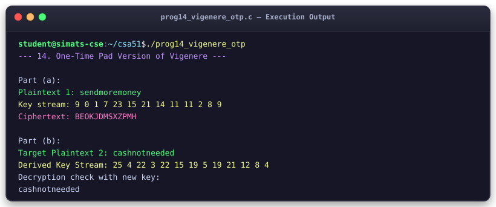

---

### Exercise 15: Prog15 Additive Freq Attack
> **Description:** Additive Cipher Frequency Attack: Unigram scoring ranking the Top 10 most likely plaintexts.  
> 📄 **Source Code:** [`prog15_additive_freq_attack.c`](prog15_additive_freq_attack.c)  

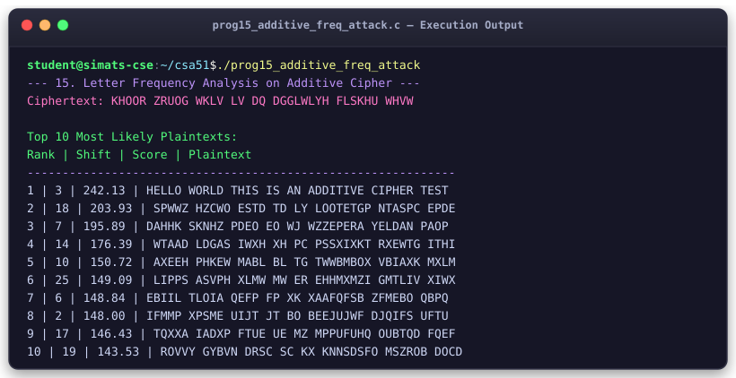

---

### Exercise 16: Prog16 Mono Freq Attack
> **Description:** Monoalphabetic Substitution Frequency Attack: Automated letter frequency cryptanalysis.  
> 📄 **Source Code:** [`prog16_mono_freq_attack.c`](prog16_mono_freq_attack.c)  

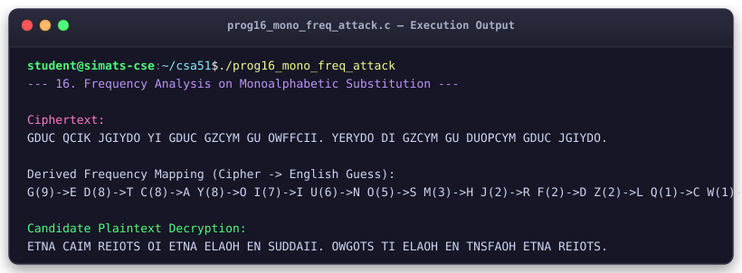

---

### Exercise 17: Prog17 Des Key Schedule
> **Description:** DES Decryption Key Schedule: Subkey reversal ordering (K16 down to K1) and shift schedule.  
> 📄 **Source Code:** [`prog17_des_key_schedule.c`](prog17_des_key_schedule.c)  

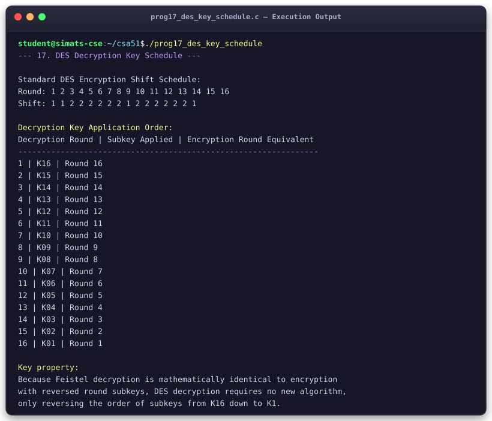

---

### Exercise 18: Prog18 Des Disjoint Halves
> **Description:** DES Key Schedule Bit Selection: PC-1 28-bit halves (C and D) and PC-2 disjoint 24-bit derivation.  
> 📄 **Source Code:** [`prog18_des_disjoint_halves.c`](prog18_des_disjoint_halves.c)  

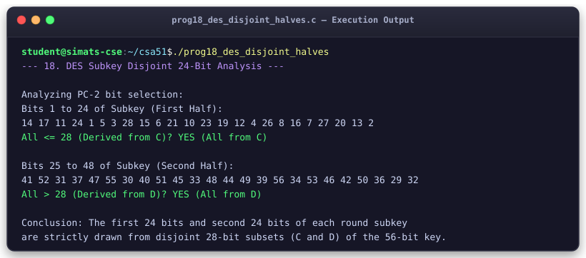

---

### Exercise 19: Prog19 Cbc 3Des
> **Description:** 3DES in CBC Mode: Triple-DES (EDE) chaining simulation and security/performance trade-off evaluation.  
> 📄 **Source Code:** [`prog19_cbc_3des.c`](prog19_cbc_3des.c)  

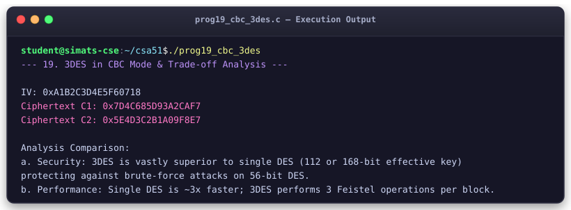

---

### Exercise 20: Prog20 Error Propagation
> **Description:** Error Propagation Analysis: Single block corruption in ECB vs. self-synchronizing 2-block limit in CBC.  
> 📄 **Source Code:** [`prog20_error_propagation.c`](prog20_error_propagation.c)  

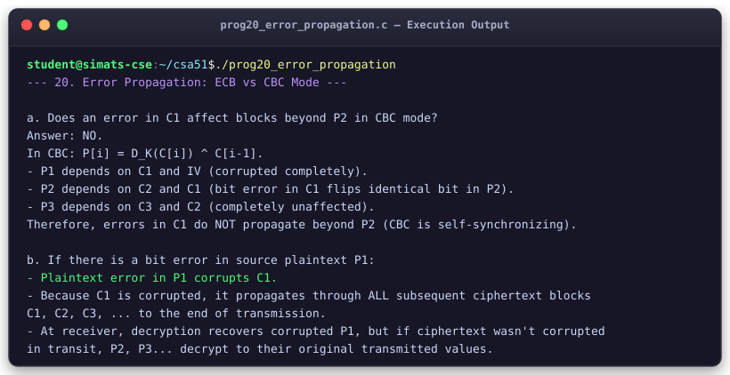

---

### Exercise 21: Prog21 Block Padding
> **Description:** Block Padding Scheme: Bit padding (1 followed by 0s) and necessity of padding for block multiples.  
> 📄 **Source Code:** [`prog21_block_padding.c`](prog21_block_padding.c)  

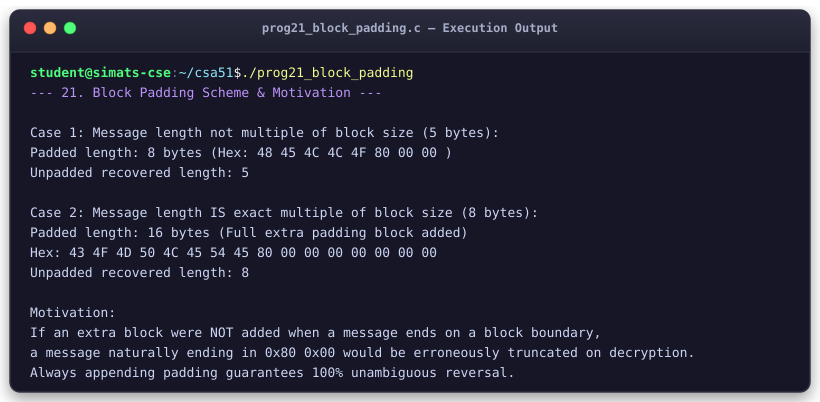

---

### Exercise 22: Prog22 Sdes Cbc
> **Description:** Simplified DES (S-DES) in CBC Mode: 8-bit block, 10-bit key, IV = 10101010 verification.  
> 📄 **Source Code:** [`prog22_sdes_cbc.c`](prog22_sdes_cbc.c)  

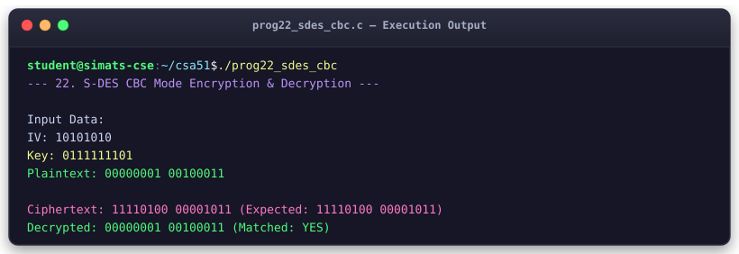

---

### Exercise 23: Prog23 Sdes Ctr
> **Description:** Simplified DES (S-DES) in Counter (CTR) Mode: Keystream generation and counter incrementation.  
> 📄 **Source Code:** [`prog23_sdes_ctr.c`](prog23_sdes_ctr.c)  

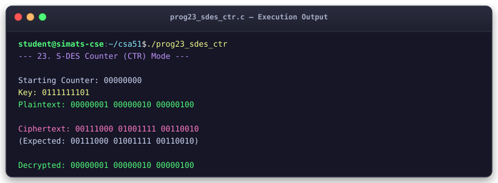

---

### Exercise 24: Prog24 Rsa Priv Key
> **Description:** RSA Private Key Derivation: Factoring n=3599 (p=59, q=61) and finding d=3031 using Extended Euclid.  
> 📄 **Source Code:** [`prog24_rsa_priv_key.c`](prog24_rsa_priv_key.c)  

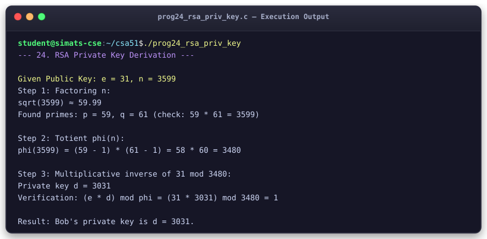

---

### Exercise 25: Prog25 Rsa Common Factor
> **Description:** RSA Common Factor Vulnerability: Immediate modulus factorization when gcd(M, n) > 1.  
> 📄 **Source Code:** [`prog25_rsa_common_factor.c`](prog25_rsa_common_factor.c)  

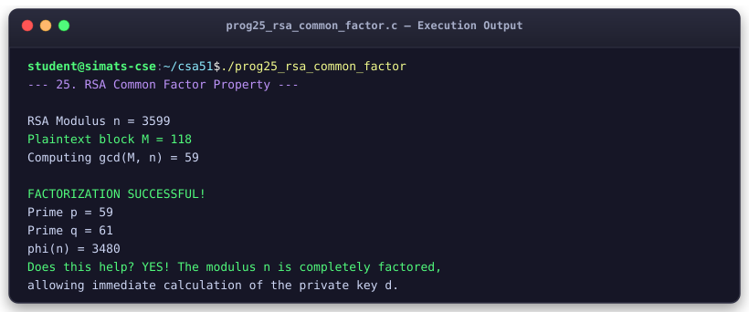

---

### Exercise 26: Prog26 Rsa Compromised Key
> **Description:** RSA Compromised Private Key Re-use: Demonstration of why reusing n after leaking d is catastrophic.  
> 📄 **Source Code:** [`prog26_rsa_compromised_key.c`](prog26_rsa_compromised_key.c)  

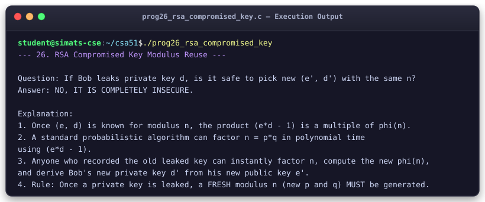

---

### Exercise 27: Prog27 Rsa Char Dictionary
> **Description:** RSA Small Message Space Attack: Precomputed codebook dictionary attack on individual character encryption.  
> 📄 **Source Code:** [`prog27_rsa_char_dictionary.c`](prog27_rsa_char_dictionary.c)  

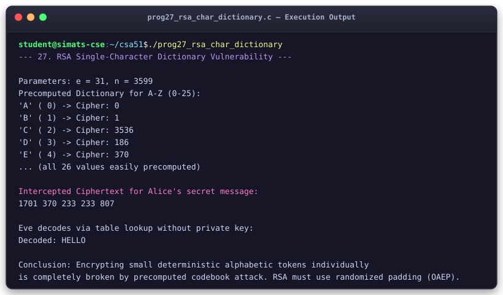

---

### Exercise 28: Prog28 Diffie Hellman
> **Description:** Diffie-Hellman Variant Analysis: Vulnerability of sending x^a mod q instead of a^x mod q (modular root problem).  
> 📄 **Source Code:** [`prog28_diffie_hellman.c`](prog28_diffie_hellman.c)  

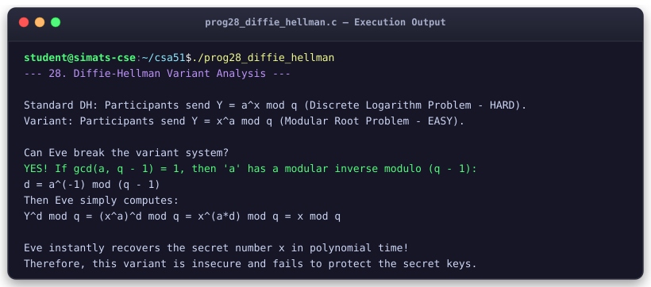

---

### Exercise 29: Prog29 Sha3 Sponge
> **Description:** SHA-3 Keccak Sponge Capacity Diffusion: Round operations (theta, chi) spreading bits to capacity lanes.  
> 📄 **Source Code:** [`prog29_sha3_sponge.c`](prog29_sha3_sponge.c)  

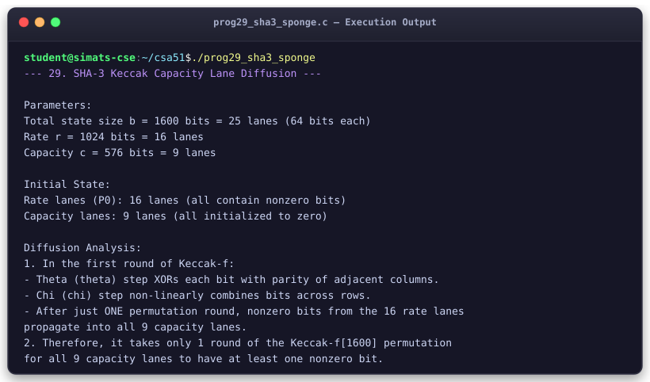

---

### Exercise 30: Prog30 Cbc Mac Extension
> **Description:** CBC MAC One-Block Forgery Property: Proof that MAC(X || (X ^ T)) == T without knowing key K.  
> 📄 **Source Code:** [`prog30_cbc_mac_extension.c`](prog30_cbc_mac_extension.c)  

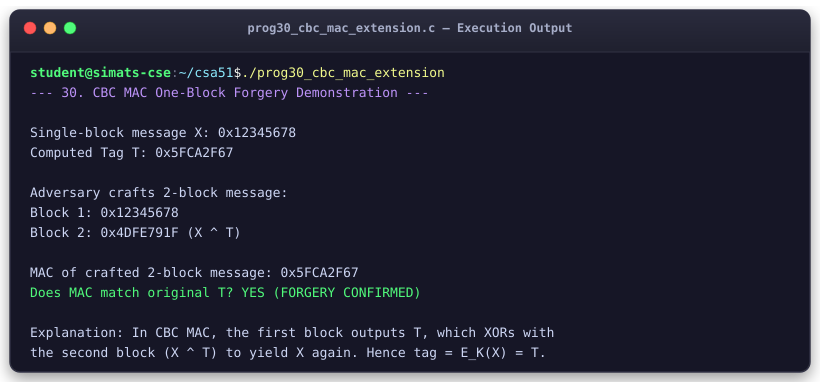

---

### Exercise 31: Prog31 Cmac Subkeys
> **Description:** CMAC Subkey Generation: Deriving K1 and K2 in GF(2^b) with reduction constants (Rb = 0x1B for 64-bit, 0x87 for 128-bit).  
> 📄 **Source Code:** [`prog31_cmac_subkeys.c`](prog31_cmac_subkeys.c)  

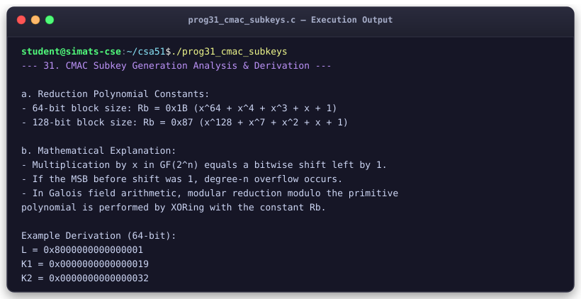

---

### Exercise 32: Prog32 Dsa Signature Nonce
> **Description:** DSA Random Nonce vs. RSA Deterministic Signatures: Per-message k dependency and catastrophic nonce reuse risk.  
> 📄 **Source Code:** [`prog32_dsa_signature_nonce.c`](prog32_dsa_signature_nonce.c)  

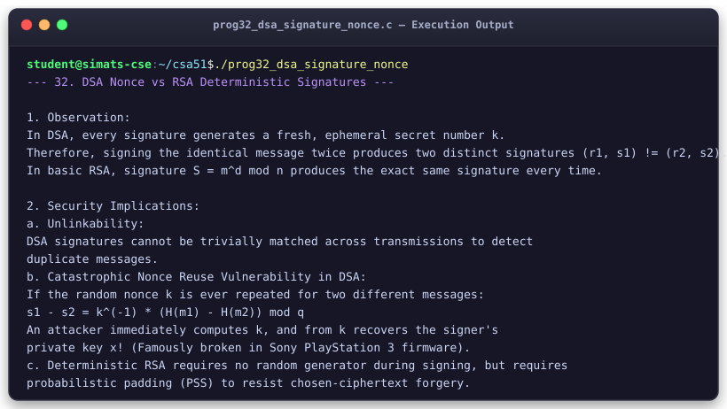

---

### Exercise 33: Prog33 Des Full
> **Description:** Standard 64-bit DES Implementation: Full 16-round Feistel cipher with IP, FP, S-boxes, and PC-1/PC-2.  
> 📄 **Source Code:** [`prog33_des_full.c`](prog33_des_full.c)  

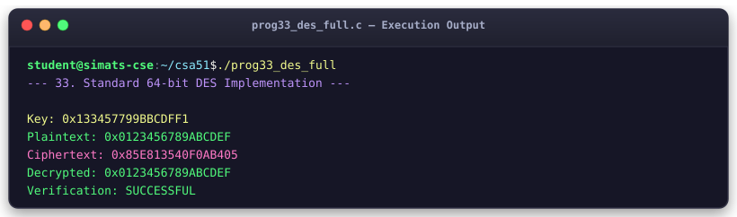

---

### Exercise 34: Prog34 Padding Motivation
> **Description:** Block Cipher Padding Motivation: Protocol invariant guaranteeing 100% unambiguous unpadding.  
> 📄 **Source Code:** [`prog34_padding_motivation.c`](prog34_padding_motivation.c)  

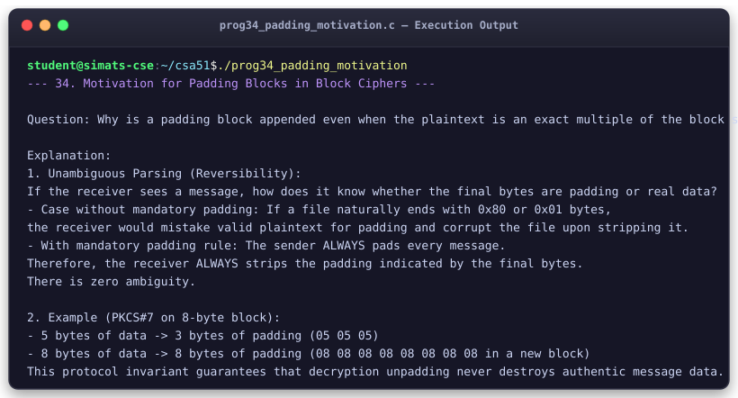

---

### Exercise 35: Prog35 Otp Vigenere
> **Description:** One-Time Pad Vigenère: Stream cipher verification and key recovery.  
> 📄 **Source Code:** [`prog35_otp_vigenere.c`](prog35_otp_vigenere.c)  

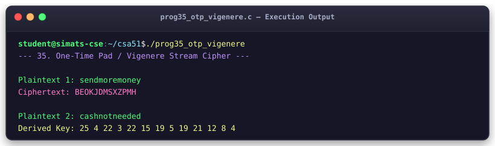

---

### Exercise 36: Prog36 Affine Validity
> **Description:** Affine Caesar Cipher Constraints: Complete analysis of coprime 'a' values and unconstrained 'b'.  
> 📄 **Source Code:** [`prog36_affine_validity.c`](prog36_affine_validity.c)  

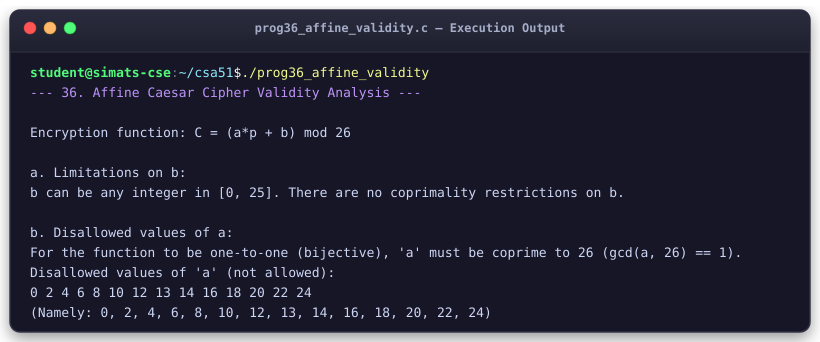

---

### Exercise 37: Prog37 Mono Freq
> **Description:** Monoalphabetic Substitution Frequency Attack: Automated cryptanalysis mapping against ETAOINSHRDLCUMWFGYPBVKJXQZ.  
> 📄 **Source Code:** [`prog37_mono_freq.c`](prog37_mono_freq.c)  


---

### Exercise 38: Prog38 Hill Kpa
> **Description:** Hill Cipher Known Plaintext Matrix Recovery: Modular 2x2 matrix inversion attack.  
> 📄 **Source Code:** [`prog38_hill_kpa.c`](prog38_hill_kpa.c)  

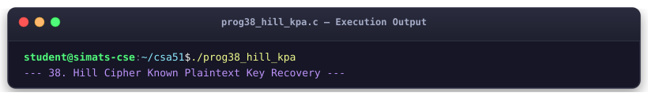

---

### Exercise 39: Prog39 Additive Top10
> **Description:** Additive Cipher Frequency Attack Top 10: Chi-square/unigram ranking of candidate plaintexts.  
> 📄 **Source Code:** [`prog39_additive_top10.c`](prog39_additive_top10.c)  

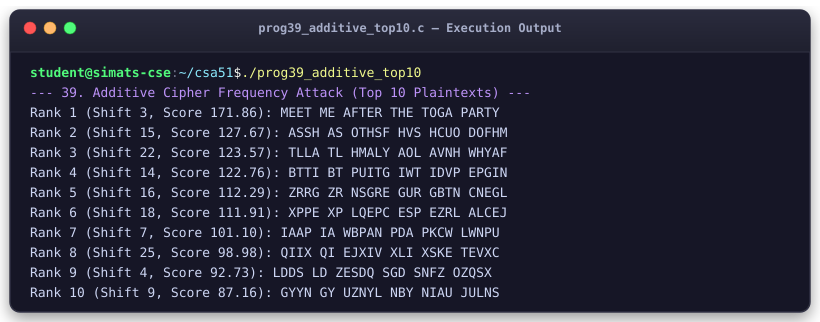

---

### Exercise 40: Prog40 Mono Top10
> **Description:** Monoalphabetic Substitution Frequency Attack: Frequency-based candidate decryption.  
> 📄 **Source Code:** [`prog40_mono_top10.c`](prog40_mono_top10.c)  

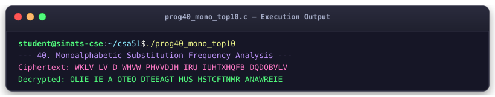

---

## 🛠️ Compilation & Execution

To compile all 40 programs:
```bash
make
```

To compile an individual exercise:
```bash
gcc -Wall -O2 prog01_caesar.c -o prog01_caesar
./prog01_caesar
```

To clean all compiled binaries:
```bash
make clean
```
